# Party-toy game style: audit, example and migration plan

Proposal from 2026-11-22, implemented in the game on the
`design/party-game-style` branch by 2026-11-23 (see
[Implemented in the game](#implemented-in-the-game)). It answers three
questions: what the garden would look like in a toy-diorama style close to
modern party board games (reference: Super Mario Party Jamboree), what has to
change to get there, and how the rules are written down so new work follows
them. The rules themselves are in [GAME_ART.md](../GAME_ART.md).

## Summary

- The game looked flat for four measurable reasons, and three of them were
  renderer settings rather than art. See [Where the game is today](#where-the-game-is-today).
- Renderer changes alone, with no model touched, get roughly half of the way.
  The rest needs reshaped models: rounded bevels, chunkier proportions and
  smooth shading.
- The recent HUD icons and operation illustrations already use this shape and
  colour language, so the 3D scene moves toward them, not away.
- Status on 2026-11-23: the renderer, the palette and every model in
  `assets/game-assets.json` now follow [GAME_ART.md](../GAME_ART.md). What is
  still open is in [Not done yet](#not-done-yet) and
  [Open decisions](#open-decisions).

Decided on 2026-11-22 after the first review:

- The floor stays continuous. Only the outer edge of the terrain is bevelled
  and shows the soil body. No visible tiles and no alternating grass tones.
- Natural materials get painted textures, used sparingly. A first procedural
  set with visible grass blades and a leaf pattern on canopies was rejected as
  ugly. Textures are now generated with the image model, kept very calm, and
  left off grass detail and tree canopies.

Decided on 2026-11-23:

- Every season and every time of day gets the bright party look. Autumn,
  harvest, Halloween and winter are no longer muted, and night, dawn and
  sunrise, morning, sunset and dusk are light and colourful. See
  "Time of day and seasons" in [GAME_ART.md](../GAME_ART.md).

## Implemented in the game

| Before | After |
| --- | --- |
| 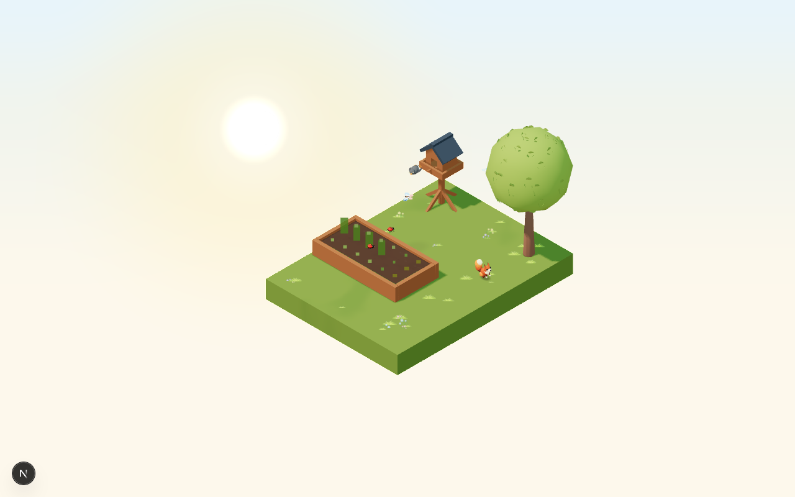 | 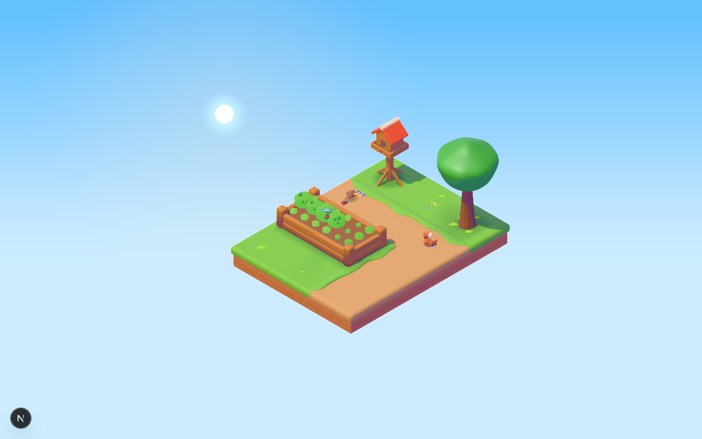 |

The after image is the real game at
`/debug/profile/game?profile=default&legend=0&date=2026-06-15&quality=high`
in the garden app, captured at 1280×800 on 2026-11-23. The before image is the
same garden and date, captured on 2026-11-22 before any change.

| Night | Sunset |
| --- | --- |
| 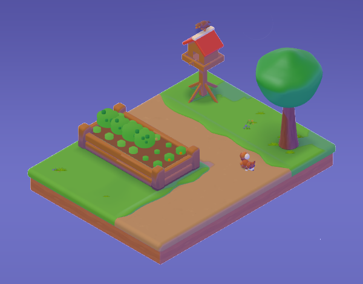 | 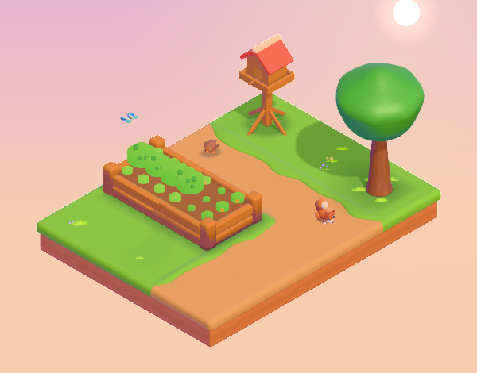 |
| **Autumn** | **Winter, snowing** |
| 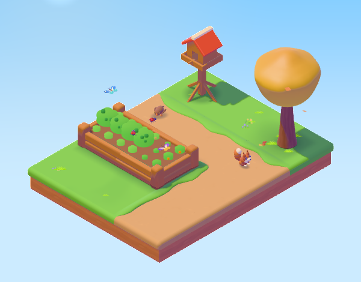 | 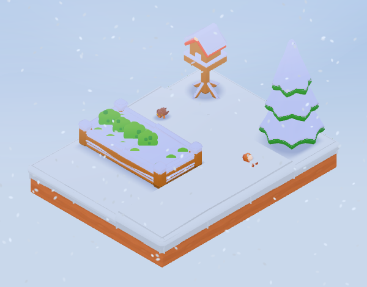 |

The same garden, cropped: 22:30 with `mode=night` and 20:15 on 2026-06-15,
midday on 2026-10-20, and midday with `mode=snow` on 2026-01-15. In the snow
view the debug profile puts a pine where the tree stands.

What changed in the renderer:

- **Tone mapping and lights.** Khronos neutral tone mapping at exposure 1.
  `packages/game/src/scene/gameArtStyle.ts` holds one light frame per time of
  day (night, before sunrise, sunrise, morning, midday, sunset, dusk), and
  `scene/atmosphereLighting.ts` eases between them. By day each frame has a
  warm key, a hemisphere fill with a periwinkle sky and a warm ground bounce,
  and a small cool ambient. At night the key is a pale lavender and the fill
  is blue-violet. The key stays between elevations 0.8 and 0.9 and comes
  from the camera's side of the garden, following the camera itself, so one
  visible side is always lit. The static scene cache gates on the same tone
  mapping constant.
- **Times of day.** Every time of day is light and colourful. The night key
  is about half the midday key (3.8 against 7.5), so tops sit at about 0.8 of
  their midday value and grass stays green: the night grass top measured
  `#6aa942` (value 0.66), against `#1d4d1b` in an earlier night capture. Dawn and sunrise have a
  pink-coral sky over a peach-lit garden, sunset is warm gold and dusk is
  lilac. Late-autumn and winter dusks and nights are as light as summer ones.
- **Weather.** Cloud and fog take most of the key away and brighten the fill
  in a pale lavender, so overcast, rain and storm stay light and keep their
  saturation (grass 0.61 to 0.66). The heaviest weather keeps 15% of the key,
  so the three values still read. Fog keeps most of the colour at the garden
  centre and fades only the back into the sky. At night cloud takes only a
  quarter of that key and fill change (`cloudNightScale`), so a cloudy or
  rainy night keeps green grass and orange soil instead of a pink wash.
  Since 2026-11-25 that light follows cloud cover
  (`gameWeatherLightRig.coverDimming`). Cover from 0.75 up (the snow, cloudy
  and rain presets, and every 'cloudy' live symbol) keeps all of it; 0.66
  keeps 60%, 0.6 half and 0.4 about a sixth, so a partly cloudy, showery or
  stormy garden under broken cloud stays close to the sunny one. Fog days
  keep theirs, and nights keep their cloud fill. Live rain, storm and snow
  under 'sunny, medium clouds' symbols (cover 0.66) get about 60% of the
  full-cover look; 'cloudy' rain, storm and snow symbols (cover 1) are
  unchanged.
- **Weather effects** (2026-11-24, [GAME_ART.md "Weather"](../GAME_ART.md#weather)).
  `Environment.tsx` mounts one provider, `scene/weather/WeatherFrameContext.tsx`
  (the blended weather, a damped storm amount, colour roles per time of day,
  tier caps, reduced motion, the garden's on-screen footprint and the sky
  layout), and one list of layers, `scene/weather/WeatherLayers.tsx`:
  - clouds only in a band across the top of the view, from soft seeded lobes
    in one screen-space shader (two draws: over the sky, and at half opacity
    over the garden's far edge), a continuous deck from cloudy 0.8 and a
    faint haze; under high cover with rain or storm the sky and the clouds
    go a soft grey at the same luminance (`scene/weather/sky/skyGrey.ts`,
    2026-11-26), and the island keeps its colour;
  - moving lilac cloud shadows as analytic ellipses in the lit materials and
    the static cache, reaching the fill light; they drift sideways on screen
    toward the same side as the band clouds at every view rotation, from one
    resolver (`resolveCloudDrift`, 2026-11-26);
  - slim streak rain (840 drops in heavy rain on high), splash rings,
    puddles on path and bare soil and a richer, never darker wet look on the
    flat ground blocks, their soil, sand and grass ramps and corners, and the
    terrain rim (no wet overlay copies since 2026-11-25);
  - two-tone discs and vector icon snowflakes, sparkles on full cover (no
    render lease of their own) and the rim lip; grass takes a light dusting
    from about 2 cm and is full at 3.5 cm, and the round tree is bare in
    winter with snow lines on its branches;
  - ground mist bands, back haze, and soft rim and sky mist rolls drawn like
    the band clouds (one instanced draw) in free sky;
  - a yellow icon bolt that hangs from the deck's lower edge with a warm glow
    only at its root, and no light, fog or sky flash;
  - wind swooshes, tumbling leaves and plant sway from one wind scale (the
    live API wind as well as the debug override).

  Every layer holds a render lease only while it moves. Reduced motion
  comes from one hook. Test it at `/debug/profile/game` with
  `mode=partly|cloudy|lightrain|rain|storm|snow|fog|windy`, `zoom=`,
  `reducedMotion=1`, `hideWeather=rain|snow|lightning|sky` and
  `lightning=at:<seconds>`. The visual target is
  [game-party-style/weather-scene.html](game-party-style/weather-scene.html).
- **Sky.** The day sky is a clear blue overhead that pales toward the
  horizon, with a smaller sun and a faint glow. Sky palettes for every time of
  day were retuned to match the light frames.
- **Toy surface shader.** `scene/surfaceGradientShaderChunk.ts` adds two
  things to every lit standard material. A height gradient lights the sides
  of props a little darker and cooler near the floor and lighter toward the
  top; up-facing faces and the bottom layer of terrain are left alone. A
  shade veil (`gameShadeVeil`) cools and lifts the fill on faces the key does
  not reach and adds a little periwinkle: lightly by day, so shadows on sand
  read lilac grey instead of olive, and more at night, so shaded sides and
  cast shadows read blue-violet while lit tops keep their colour. It switches
  off under even weather light. `scene/skyRimShaderChunk.ts` adds a soft
  sky-coloured edge to rounded surfaces that fades just before the
  silhouette.
- **Contact shadows.** Every standing static entity gets a soft, cool-tinted
  blob (`entities/helpers/StaticContactShadows.tsx`, with its layout,
  profiles and `scene/contactShadowStyle.ts`). All blobs draw as one instanced
  mesh on every quality tier: full strength on the low tier, which has no
  shadow maps, and half strength elsewhere. Blobs rise above snow, tree and
  bush crown pools fade with the autumn canopy stage, and animal and
  placement shadows use the same ground lookup. Terrain and flat ground cover
  get no blob.
- **Water.** Water is now a lit, opaque material in the water role
  (`entities/waterBlockMaterial.ts`, colours in `scene/waterColorState.ts`),
  with a rounded lip on every exposed top edge (`entities/waterBlockRim.ts`)
  and a soft glint that freezes under reduced motion. It is clearly blue at
  every time of day: a lone tile in the dense garden measures `#39aef6` at
  midday and `#309af4` at night. The pale holes had two causes, both older
  than this branch. Water was an unlit, see-through shader material (pale aqua
  `#8eddd3`, near-white foam `#fbfffb`, no depth write). A water block replaces
  the ground block, so a lone tile is a bank on every side and its top turned
  almost entirely into foam at about 0.5 to 0.6 opacity, over the empty sky
  under the island. The z-facing side walls were also wound against their
  normals, which the unlit shader hid; that is fixed and tested. The unused
  `waterColors` state and `scene/waterColors.ts` are removed. To view a lone
  block, use `/debug/entities/Block_Water`: `BlockWater` is not an entity name
  and shows the unknown-entity placeholder.
- **Waterfalls.** Every exposed side of garden water is a waterfall
  (`entities/waterfall/`). The exposed sides are the rounded-rim sides
  (`resolveWaterRimExposure`), so every foamy lip sits over a fall;
  `waterfallPlacements.ts` adds where each one lands: the neighbour's bottom
  run of terrain, read with the rim's own shape heights
  (`terrainRim/terrainShapes.ts`), so a fall lands along a ramp's slope, a
  ramp's toe or a stair step; a lower water top; or nothing at the island
  edge. Water beside water at the same level, or terrain as high as the
  water (a bank, a ramp's crest), shows no fall. The exposed wall is the
  falling sheet, drawn by the water shader from a per-vertex floor: a foam
  crest under the lip, which foams too, soft light dashes that slide down at
  0.55 units per second, and white churn where it lands. One merged mesh per
  water chunk adds a scalloped foam skirt with a rolling ring on the landing
  surface (patched round outer corners, mitred in inner corners, tapered at
  free ends, tilted along a ramp's toe or crest, none on a ramp's side,
  corners or stairs); a spill where water on a taller support lands below
  that support's top, pouring over its grass lip down to the landing with
  the skirt at its foot; and, at the island edge, a run-out that spills over
  the support block's grass lip, falls past the island base and fades into
  mist. Water on a ramp or corner fills it down to its base, so it stands
  on the block under the ramp (or on nothing at ground level), and its
  spill or run-out starts from that block's top, below the water. It falls
  only over the block's low sides, where its top stays at its base all
  along (a ramp's toe, a corner's two low sides; none of an inner corner).
  The bank holds it on its crest and its sloping sides, which show a plain
  water wall above the slope: a fall there poured over the bank's soil
  face, as if through the block (2026-11-27). Water stacked above the ramp
  or corner it fills
  stands taller than that bank, so each side pours over the block's top
  along it instead (`WaterfallColumn.lips`): its crest, a slope or a low
  side, and the sheet covers the ramp's soil rather than falling behind it.
  Water never freezes, so falls keep
  flowing in winter. Once the quality tier draws snow on the grass
  (`useWaterfallSnowLies`, the terrain rim's snow-lip rule), skirts on
  terrain fade as snow settles, and the
  shoulder of a spill or run-out lifts over the snow on its support's lip,
  so no snowy ledge cuts the fall, tucking under the snow of ground beside
  it that is nearly as high as the lip, such as a ramp's crest or high end.
  Everything runs
  on the existing `water-surface-animation` time, holds still under reduced
  motion or fixed time, and the low tier drops the second noise octave, the
  ring and the mist. The per-entity `BlockWater` (catalogue, previews) is
  unchanged.
- **Night lights.** Lamps and lanterns use the warm lamp and lantern glow
  roles by day and their emissive colour at night. Each garden light also
  gets a soft additive halo (`entities/helpers/gardenLightHalo.ts`) that
  fades in with the night glow, and pumpkin lanterns glow clearly at night.
- **Snow.** Snow cover, snow blocks and snowflakes use the snow role, lit
  and tone mapped like other surfaces, instead of paper white. Covered faces
  keep only part of the light's tint, so snow tops measure `#cdd8ec`. Snow
  thickness noise is sampled in world space, so neighbouring blocks agree and
  no joint lines show inside the garden. Smoke from warm props uses the
  ghost lilac role.
- **Terrain edge.** `entities/terrainRim` adds a rounded lip and a soil body
  on exposed terrain sides and outer corners only. Blocks stay flush cubes, so
  the floor is continuous. The lip uses the block's own ground material and
  gets wet and snowed on with it. The soil body carries the generated
  `terrain-soil` texture. Ramps, outer and inner corners and stairs wear the
  same rim (`terrainRim/terrainShapes.ts` describes their tops): the lip runs
  down a ramp's sides, shades into the slope at its back wall and rounds its
  toe as a small nose, and stairs get a lip on each step: the upper step's
  ends flush with the riser in a flat face, the lower step's curls into the
  riser's foot; on the lower step's front the lip runs in over the GLB's own
  rounded nosing, so no groove shows between them. The stone blocks pave
  their tops with separate rounded slabs, and where the groove between two
  slabs reaches a side, the stone lip dips with it, its top rounding down
  into the groove and the dip fading out toward the lip's underside
  (`terrainSideGrooves` in `terrainShapes.ts`, measured from the GLBs:
  nine slabs 0.03 deep on stone blocks and ramps, two per step 0.045 deep
  on the stairs, 2026-11-27). A side shows wherever the
  block stands above its neighbour's top along the shared edge, so a flat
  block beside a ramp's low end is rimmed too. There a grass, soil or sand
  lip shrinks to the height it shows and tapers away where the slope reaches
  it; a stone, polished-stone or gravel lip keeps its full size and sinks
  into the slope like a kerb, because a tapered hard edge read as a horn. A
  block carrying a ramp keeps its lip under the ramp's toe. Caps close a run
  only where nothing carries the lip on. Water beside a ramp's toe or side
  rounds over like water at the island edge. In snow, the folds of ramp and
  corner tops are bridged (`helpers/weatherCreaseBridges.ts`) so the cover
  does not crack along them, a high edge with no wall in the same mesh (the
  back of a grass ramp, the walls of a grass inner corner) gets a welt that
  lifts straight up with the level top beside it, a toe gets a hem that folds
  the slope's cover down onto it while the unseen bottom stays put (a bridge
  to the bottom stood up as a grey band along the toe), and a lip down a
  slope measures its snow from its own top edge, so it
  shows no green line. A terrain block that is picked up or dragged in from the HUD wears
  the same rim, as its own small island, and the hole it leaves is rimmed
  like a real gap (`terrainRim/terrainRimDragPlacements.ts`, 2026-11-26).
  Dirt ramps draw the shared `BlockSandAngle` wedge in the flat dirt
  material, so their top is the slope the rim follows (`BlockGroundAngle.glb`
  is no longer drawn), and dirt ramps and corners take the wet look like the
  flat dirt beside them. The rim takes its lip, and the stone body, from the
  flat block's GLB, so each ramp, corner and stairs lists that GLB in the
  scene manifest too (`scene/resources/gardenSceneManifest.ts`).
- **Path edges.** Where lawn meets a soil or sand path at the same height,
  `entities/terrainRim` adds a low grass bank that rolls onto the path along a
  wandering edge, with rounded outer corners and filled inner ones. The bank
  casts no shadow, and its row where it meets the lawn has its normals
  pointed straight up to soften the line there. The default mock garden has a
  soil trail so this shows.
- **Bounce.** Placing a block drops it in stretched and lands it with a
  squash. Picking a block up, dropping a moved block, clicking one and
  harvesting each play their own squash or hop, with volume kept. The values
  are in `entities/helpers/bounceMotion.ts`; harvest uses
  `raisedBed/raisedBedHarvestBounce.ts`. Terrain does not hop on click.
  Tap, pickup and land bounces play in place without remounting the entity
  (`resolveBlockPlacementDropAnimationRenderIdentity`), so props can be
  dragged and double-click rotated during them; only a new placement's drop
  remounts.
- **Hover pop.** A hovered component entity grows to 1.07, overshoots once
  to about 1.08 and settles in about 260 ms (`HoverOutline.tsx`).
- **Idle breathing.** Tree and bush canopies, pines, palms, maples, the
  autumn shrub, roses, sunflowers, tulips, aster-pot flowers, cactus blooms,
  crops, sheep, cows and rabbits breathe at rest: 2% to 3.5%, one
  cycle about every four seconds with a ±10% period jitter, each with its own
  phase (`scene/idleBreathing.ts`, `scene/IdleBreathingMotion.tsx`). Batched
  geometry breathes in the vertex shader. A plant holds still while a weather
  overlay covers it, and in rain (a rule left from the retired wet
  overlays, see "Not done yet"). Breathing only advances on frames the scene already
  draws: once a pop or bounce settles, the static idle scene draws nothing.
- **Reduced motion.** Bounce, hover pop, breathing and water motion all stop
  under `prefers-reduced-motion`.
- **Crops.** Crop colours come from `generators/plant/lib/cropPalette.ts`,
  generated by `assets/scripts/party-pass-crops.py`. Stems are about 1.5×
  thicker and at least 0.032 wide in the world, produce is 1.3× and flowers
  1.25× larger, leaves are rounder, and compound fronds are broad oval
  leaflets. Every plant part is metalness 0 with roughness by band. The
  distant and mid-distance cards are rounded leaf clumps with up to three
  seeded produce dots, drawn in two passes so overlapping cards have no halo,
  and sized from the 3D plant so zooming in does not jump.
- **Legacy materials.** Matte materials that also had metalness lose the
  metalness when a model loads, because it only darkened them.

What changed in the palette:

- **Base and seasonal roles.** The base roles and the seasonal roles in
  [GAME_ART.md](../GAME_ART.md) are in `assets/scripts/party_style.py`
  (`SCREEN_ROLES`, `SEASONAL_ROLES`) and `scene/seasonalRoles.ts`, with the
  albedo to author. `AUTUMN_REMAP` and `SEASONAL_REMAP` map every old seasonal
  colour to a role. A unit test keeps the Python and TypeScript tables in
  sync.
- **Autumn and spring.** Canopies turn from summer green to gold, amber,
  orange and red (`autumnCanopyStops`), with per-seed phases so mid-autumn
  shows all four side by side and winter remnants vary from red to amber.
  Falling and settled leaves and the leaf-raking puff use the same roles.
  Spring canopies lean up to 35% toward the spring green role, then return to
  summer green.
- **Holidays.** Gift boxes, the snowman, the advent pine and its star and
  lights, and the pumpkin-trail badges take their colours from the roles.
- **Instanced paths.** Instanced and retained renderers draw every restyled
  asset with the same colours as its single entity: pots (`potPalette.ts`),
  gift boxes, the cat pillow, the watering can, cactus, desert stone, dead
  tree, snow, dry and swamp ground, and the raised-bed accessories (weeds,
  frost fleece, insect net, supports and sown seeds,
  `raisedBedAccessoryPalette.ts`).
- **Wood.** The default plank moved a step toward gold (`#7d4422` to
  `#875627`), and the fence gate, autumn fence gate and stick now use it.

What changed in the catalogue:

- **Every model.** All 174 models in `assets/game-assets.json` changed.
  Nearly all are reshaped and recoloured: chunky rounded forms, smooth
  shading and colours on the roles. Every material has metalness 0. The few
  models that are not fully restyled are listed under
  [Not done yet](#not-done-yet). Footprints, pivots and object names are
  unchanged, and `glbdiff` is ok for every asset apart from the material added
  to `Stick` and `Seed`, which had none.
- **Sources.** `assets/scripts/generate-party-core.py` rebuilds the core set
  (raised bed, fence, tree, bush, bird house, stones and terrain colours). The
  `assets/scripts/party-pass-*.py` scripts rebuild the rest: terrain,
  structures, nature, props, pots and bottles, lights and summer, animals,
  animal homes, autumn, harvest and crops. They share the bevel, normal and
  colour helpers in `party_style.py`.
- **Size.** In the final audit the 175 GLBs totalled 10,823,608 bytes,
  against 17,359,700 before (−37.7%). Triangles across all GLBs rose 22%,
  from 273,659 to 333,149.
- **Images.** Block covers (1,026 files), top-down images (791, plus 16 new
  gate files) and plant images (150) were regenerated from the game, and all
  24 release manifests were rebuilt with their `build-*-release.ts` scripts.

What did not change, on purpose:

- **Exposure.** A sunlit top face still receives about 3.2 times the light
  that would show its albedo unchanged (`SUNLIT_GAIN` in `party_style.py`).
  Every authored colour in the game assumes this, so changing it means
  recolouring everything at once. New colours are therefore authored darker
  than they appear.
- **Shared wood.** Wooden props share a few wood profiles, kept in sync by
  `assets/apply-bridge-wood-palette.py` and enforced by
  `timberAssetPalette.unit.ts`, so the raised bed and fence match the bird
  house, bench and the rest. They change as a whole, not per prop.

## Animal redesign

Done 2026-11-24, after feedback that the animals still looked bad. The first
animal pass (`party-pass-animals.py`) only smoothed the old low-poly meshes
in place, so they kept long bodies, stick legs, small heads and lumpy,
faceted surfaces. All 17 animals are now rebuilt from scratch as toy
figurines, to the rules in GAME_ART.md, "Animals".

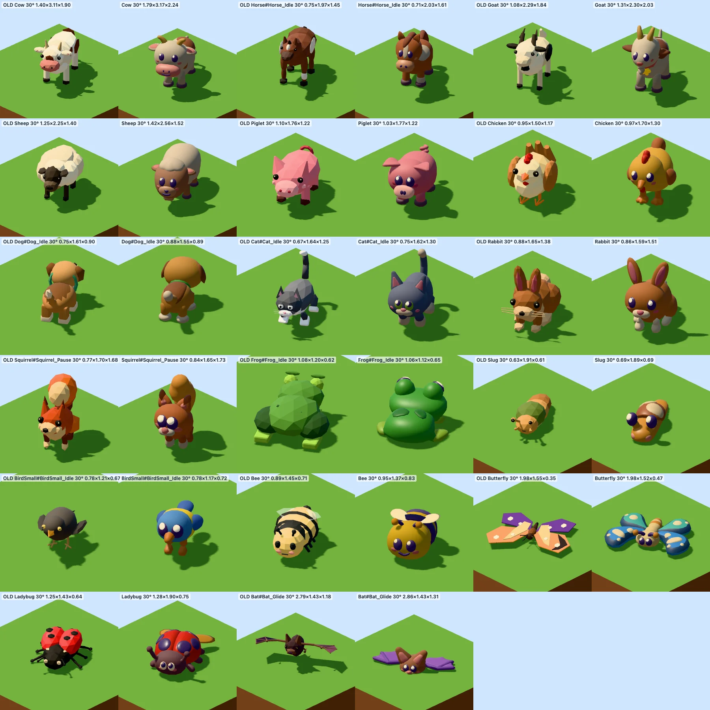

Each pair shows the model at the branch point and the redesign, both loaded
from the exported GLB in the same viewer, light and 30° camera; clip-animated
animals are in the first frame of their idle clip. The labels give width,
length and height in model units. The ladybug's orange underwings show only
here: the game hides them until it flies.

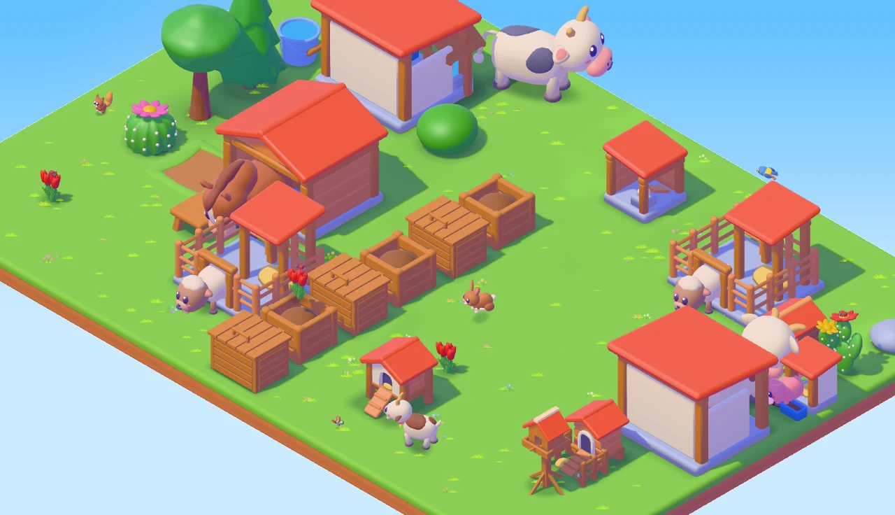

The real game at
`/debug/profile/game?profile=fauna-heavy&legend=0&quality=high&date=2026-06-15`,
captured at 1280×800 on 2026-11-24 and cropped.

### Method

1. **Direction.** Three directions were explored and judged; a plush chibi
   style won, with a few ideas taken from the others.
   The character language comes from the team's avatars
   (`packages/ui/src/Avatar/assets`): big heads, ink eyes with a white
   glint, blush, a small mouth, simple markings, warm colour, and none of
   their faceted shading.
2. **Pilot.** A shared kit was built and applied to the real Cow and Cat,
   reviewed adversarially and fixed. They are the templates for the rest.
3. **Rollout.** Each of the other 15 animals got its own design module,
   then an adversarial review in the viewer and the game, then a fix pass.
4. **Set pass.** The whole set was audited for consistency (face kit,
   proportions, colour roles, smoothness, scale) and for runtime behaviour
   (rig, clips, code poses, grounding, colour variants, performance), then
   polished: finer silhouettes for the same triangles, a rebuilt frog, and
   the runtime fixes below.

### Kit and sources

`assets/scripts/party-animals.py -- --asset <Name>` opens
`assets/game-assets/<Name>.blend`, runs `party_animals/<name>.py` and saves
the .blend; `export-game-assets.py` writes the GLB as usual. The build reads
only the rig, never the old meshes, so a rerun gives a byte-identical GLB;
all 17 do. Each module has a `build` and a `check`, with the animal's
runtime scale, budget and replaced size.

`party_animals/kit.py` holds:

- primitives with clean topology: `blob` (a superellipsoid on a cube-sphere,
  with one resolution or one per axis), `lathe` and `lathe_rings`, `tube`,
  `capsule`, `slab`, `pad`, `decal` (optionally with a coarser interior),
  `spot`, `band_decal`;
- the face kit: `eye`, `blush`, `smile`, `beak`, `leaf_ear`, `slab_leaf_ear`,
  `cone_ear`;
- limbs and tails: `pivot_leg`, `limb_segment`, `mid_pivot_leg`,
  `pivot_foot` and `pivot_foot_rings` with `HOOF_RINGS`, `sliced_tail` (with
  a ring collar for colour tips), `wing_panel`, `membrane`, `hidden_nub`;
- the design spaces (`clip_pose_space`, `glb_rest_pose`, `apply_pose`) and
  the checks: size, proportions, triangles, thickness, and every clip and
  procedural pose extreme for feet on the ground, legs, head and tail in the
  body, and joints.

Helpers only one animal needs live in its module, for example the horse's
normal blending (`adopt_normals`, `blend_normals`, `shared_normals`), the
piglet's `snout_disc` and the squirrel's plume. The old `PartySource:`
meshes are gone from the 17 animal .blend files.
`party-pass-animals.py` now restyles only `FarmerAvatar` (its output is
byte-identical to before) and refuses animal names.

### What changed

Every animal is one soft body and one big head that overlap, without a neck
lump, on short round legs. Each has tall ink eyes (`#5c4590`, gloss 0.35)
with a glint at the upper left, and most have blush. Markings are a few bold
decals that wrap over the back. Colours are flat, authored by their on-screen
colour, with metalness 0.

| Family | Animals | Before | After |
| --- | --- | --- | --- |
| Farm animals | cow, horse, goat, sheep, piglet | Long faceted bodies on stick legs, small heads, black or grey accents | A plush loaf with a big head, a wide glossy muzzle, chunky hooves in one mauve role, bold patches. The horse keeps a thick neck under its mane; the sheep's fleece is one cloud with a scalloped hem; the piglet has a snout disc and a corkscrew tail; the goat has golden horns, a beard and a collar with a charm. |
| Pets | cat, dog, rabbit | Low-poly heads, whiskers, separate blocky paws | A round bean with a head about as big as the body, cream socks, cone or slab ears with linings where the rig has a node for one. The dog's legs swing about their own middle (`mid_pivot_leg`). |
| Birds | chicken, small bird | Faceted bodies, thin legs and toes | One egg with a big head, wing panels, a curled beak and chunky feet. |
| Small critters | squirrel, frog, slug, bat | Lumpy clusters, thin feelers and membranes | One bean each. The squirrel's tail is one smooth plume; the frog is a squat body with a wide head and two eye domes; the slug is one tapered loft; the bat is one fuzzy bean with big lined ears and soft violet wings. |
| Insects | bee, butterfly, ladybug | Faceted bodies, hair-thin legs and antennae | Round bodies read by silhouette and colour blocks: wrap-round bee stripes, cushion butterfly wings, a glossy ladybug dome with six big spots, and a face on each. |

Triangles in the file, before and after, from `glbdiff`:

| Animal | Before | After | Animal | Before | After |
| --- | --- | --- | --- | --- | --- |
| Cow | 2,248 | 3,886 (3,442 drawn) | Squirrel | 1,232 | 2,284 |
| Horse | 2,256 | 3,428 | Frog | 2,060 | 2,294 |
| Goat | 1,772 | 3,402 | Slug | 844 | 1,938 |
| Sheep | 1,792 | 3,440 | Bat | 793 | 2,280 |
| Piglet | 1,200 | 3,408 | Small bird | 712 | 2,220 |
| Chicken | 1,318 | 3,216 | Bee | 1,594 | 1,950 |
| Dog | 3,620 | 3,438 | Butterfly | 964 | 2,232 |
| Cat | 1,826 | 3,436 | Ladybug | 1,344 | 2,444 (2,276 drawn) |
| Rabbit | 1,500 | 3,444 | **All 17** | 27,075 | 48,740 |

The cow draws one of its two coat nodes and the ladybug hides its
underwings at rest. The 17 GLBs shrank from 2,769,560 to 1,392,312 bytes. In
the `fauna-heavy` profile the frame has about 25% more triangles (117,700
against 93,900), the same draw calls, and no measurable change in GPU or CPU
frame time, measured in the set audit before the polish pass, which kept the
counts within a few percent.

Rigs are unchanged: `rigcmp` finds the same nodes, transforms, parents,
keyframes and material names as at the branch point for all 17, `glbdiff` is
`ok`, and each node keeps one material (only `Dog_Body` and `Dog_Head` had
several before and keep them). In the set audit, sampling every
`/debug/animals` scene with triggered behaviours found no visible part
detached by more than 0.002 game units; the old frog front feet and cat paws
were detached by 0.007 to 0.009. The frog rebuilt after that passes the same
checks in Blender for every clip.

Runtime code changed with the models:

- `bees/Bees.tsx` keeps gloss 0.35 on the bee's eyes, glints and smile.
- `horses/Horse.tsx` keeps the muzzle's 0.45 gloss, and the horse coats in
  `packages/js/src/entityAppearanceVariants` are retuned by on-screen
  colour, with a slate black horse and shared warm markings and muzzle.
- `rabbits/Rabbit.tsx`: the second coat's inner ear is converted to an
  on-screen colour like the first.
- `dogs/Dogs.tsx`: the dog stops further from a tree trunk in `cover`, so
  its bigger head stays outside it.
- `butterflies/Butterflies.tsx` flaps the wings about the body's long axis
  (`rotation.z`, was `rotation.y`), so they beat up and down and fold up
  over the back at rest.
- `squirrels/squirrelNut.ts` puts the acorn under the new muzzle.
- Tests pin the deliberately changed values: asset colours, the bird's
  triangles and size, the rigid fauna batch count (the bee now splits into
  four batches), and the distant bird flock snapshot.

Images: the www block covers of the five animals that are blocks (cow, goat,
horse, rabbit and sheep, 25 files) and the rabbit's four top-down images
were regenerated from the new models with `generate-playwright:blocks` and
`:blocks:top-down`. The public block directory does not list these five, so
their test cases came from `getLocalSandboxBlockData()`. No release manifest
covers an animal.

### Open decisions

1. **Triangle budget.** The farm animals and pets sit at 3,402 to 3,444 of
   the 3,450 cap. The finer hoof, ear and patch rims were paid for by
   hidden geometry. Big head and body outlines are still about 24 segments
   round and show faint steps at the closest zoom (500). Removing them needs
   about resolution 8, roughly 500 to 700 more triangles each, so a cap near
   4,000. Raise it, or accept the steps?
2. **Size.** GAME_ART allows 10% against the replaced model, but the
   modules measured against the in-place pass, which had already grown
   heads. Against the branch point, in the GLB rest pose: cow width +28% and
   height +15%, goat width +21% and height +17%, piglet width +21%, cat
   width and height +18%, dog width +16%, sheep length +14%, chicken length
   +12% and height +11%, horse height +11%, slug height +14%, bee height
   +15%, butterfly height +36%, and ladybug length +29% (its underwings,
   hidden in the game). The coop, pen and goat shelter fit as before, and
   the dog's head shows more out of the dog house. Accept, or shrink the
   farm animals?
3. **Frog blink.** `Frog_Blink` only slides the lids 0.07 down, which
   cannot cover an eye big enough for the glint rule, so the lids are
   hidden and the frog no longer visibly blinks. Accept, give the frog a
   heavy brow for a partial squint, or change the code or clip (for example
   scale `Frog_Eye_*` vertically)?
4. **Motion with nothing to move.** The slug's body wave and glide stretch
   (`Slug_MiddlePivot`, `Slug_FootPivot`) and its lower feelers drive hidden
   nubs, and the bat's elbow and hand wing nodes are nubs, because those
   pivots sit at the model origin. Move the pivots to the joints (a rig and
   code change), or accept?
5. **Critter glints.** At a runtime scale of 0.25 or less (squirrel, frog,
   slug, small bird, bat), the 0.03 game unit glint is about half the eye's
   width and reads a little googly next to the farm animals' small glints.
   Allow critter glints down to about 0.02?
6. **Insects.** GAME_ART now records the insect exception: bee, ladybug and
   butterfly faces, antennae, legs and spots go down to about 0.01 game
   units. Confirm it, or drop the insect faces?
7. **Back view and pairs.** From behind, most big-head animals read as a
   head ball on a body ball. At runtime scale the chicken (0.44 game units
   tall) is almost as tall as the piglet (0.48), the cat (0.53) is taller
   than the dog (0.42), and the horse (1.59) is only a little taller than
   the cow (1.44). Retune the entity scales, or accept?
8. **Hedgehog.** The hedgehog is a live actor (hedgehog shelter visits) but
   not part of the redesign: it is still a faceted spiky lump from the
   generic restyle. Redesign it the same way?
9. **Cow graze pitch.** A grazing cow pitches its head 64° down
   (`cowPose.ts`), so the camera mostly sees the crown. A smaller pitch
   would show more face; that is a code change.
10. **Ladybug cover.** `apps/www/public/assets/environment-animals/Ladybug.webp`,
    the ladybug's picture in the environment animal directory, is an old
    Blender render of the original low-poly ladybug, and no script in the
    repository makes it. A render of the new model at that size (768
    pixels) also shows the eight-sided antenna and leg tips, which the game
    never shows that close. Replace it, and with what?

Known limitations:

- The clip and code poses listed in GAME_ART.md, "Known exceptions", put
  some feet below the ground or lift them (cat crouch and lying clips, cow
  breathing, horse trot, squirrel forage, piglet wallow).
- `Cat_Eyelid_*` hold the cat's glints because nothing animates them. A
  future blink clip needs the glints moved first.
- The bee's glints share the wing material, so they read a little warmer
  (`#fbe5c2`) than the glint role; a glint material would be a new material
  name.
- `Dogs.tsx` `getDogMaterialTint` looks for `Material.Dog.BlackFur`, which
  the dog GLB has never had, so the tint never applies. This is older than
  the branch.
- In the `doghouse` behaviour the set audit saw the dog's head through the
  back of the dog house at two rotations, which the dog at the branch point
  also does; the polish pass found nothing passing through the wall or roof
  in three rotations. It needs one more look.
- `docs/game-fauna-world.md`: the frozen pose oracle replays manual pose
  functions, and this branch changes three of them on purpose (the
  butterfly's wing axis, the cow and rabbit breathing). The reference
  replay was not run.
- Everything is exported with Blender 5.2.2 (see below); the kit uses no
  geometry nodes or modifiers, so mesh names match 5.1.

## Not done yet

Renderer:

- Hover pop on instanced blocks (raised beds, trees, bushes, gift and garden
  boxes) and on the pickup outline. It needs a per-instance pop uniform in
  the instanced shader.
- The environment map.
- Item thumbnails and pack-layout previews draw terrain blocks without the
  rim, flat blocks included; only the garden and the HUD drag preview wear
  it.
- Snow: close up, small marks remain where rim pieces meet on slopes: a
  green fleck at some lip joints at the top of a slope, a hairline where a
  side lip meets a shaped corner piece on stacked corners, and a shaded
  wedge where a hard kerb sinks into a grass inner corner. Folds, toes and
  high edges no longer open.
- Painted textures are used only on the terrain soil body, tree and dead tree
  bark, and gravel. The world-projected ground textures, the ground-type mask
  and the wood and stone textures are not built.
- Raised terrain steps still take a little of the height gradient: nothing
  sets `GREDICE_NO_SURFACE_GRADIENT` on the ground patch and terrain rim
  materials.
- Snow: a faint line runs parallel to the front edges of the default island,
  at the terrain rim lip.
- The grass bank still shows a faint soft band where it meets the lawn.
- Night shaded sides are a little dark and read magenta-plum on red soil
  (soil side value 0.51, saturation 0.38), and the trunk's lit side is about
  value 0.44 at night.
- Night lights: the garden brazier has no halo, the firefly jar halo is
  strong, the halos were checked only in the Halloween entity grid, and the
  hazel light arch (intensity 5.6, distance 15) is much stronger than the
  other lamps and lit its neighbours peach in the entity grid. `gardenNightLightEmissivePeakMultiplier` stays at 0.2.
- Weather tone is applied twice to the sky by day, once to the background
  and once to each gradient band.
- Crops: 3D leaves at night are slightly less saturated than the cards, stem
  segments end in flat caps, the onion card shows a leafy clump where the 3D
  plant shows a bulb, lettuce and spinach look a little like succulents up
  close, and crop breathing swells each part instead of the volume-keeping
  stretch.
- Performance was not profiled with the `profile:game` scenarios. In the
  dense garden on the high tier the live scene has about 100,000 triangles,
  against about 20,000 before, mostly from the grass bank; draw calls are
  unchanged. Weather was measured on the farm (draws and triangles only; see
  "Weather restyle" in
  [game-scene-performance.md](game-scene-performance.md#weather-restyle-2026-11-24)):
  heavy rain is 510 draws and about 108,000 triangles against a budget of
  600 and about 110,000, now that the instanced block wet overlays are
  retired (they changed only 0.1 to 0.2% of pixels in full rain).
- `weatherSurfaceGeometry.ts` still builds the `aWeatherLocalPosition`
  attribute and the weather shader still declares it, but nothing reads it
  any more.

Weather (see [GAME_ART.md "Weather"](../GAME_ART.md#weather)):

- The garden footprint raises the terrain only near the homes of roaming
  ground animals (each animal's height and day range), and standing objects
  have rounded tops. Tall objects still use their block hitbox height: the
  tree's 2.38 units stand about 0.35 above its canopy, so at zoom 170 on the
  default island the deck's right side is about 115 px deep (240 px on the
  left; the target shows 100 to 240 px). On the farm every tile is in some
  animal's range, so a farm that fills the view gets the short fallback bolt
  only where it fits the band's strip off every object, and otherwise only
  the deck glow.
- Partial snow (setting in or melting) draws the overlays in the transparent
  pass, so their blocks leave the static cache until the cover is opaque
  again. Tile joints show faintly through a 3 cm dusting on paths.
- Frost costs 20 more draws in the `apps/garden/tests/cold-weather.spec.tsx`
  fixture (314 against 293 at high and medium quality, no extra triangles).
  The owner accepted this as the cost of the frost look, and the spec now
  expects 21 fewer draws on unmount (frost plus the breath draw) and still
  16 fewer triangles. Frost swaps the terrain rim and verge pieces to
  per-piece integrated weather-surface materials (the rain-only variant), so
  the stock packets they shared split by material: grass from 8 to 24 draws
  (6 materials) and sand from 4 to 8 (2 materials) over the fixture's four
  packet cells, with the same 37,308 triangles. It is the packet batching of
  the frost variants, not a weather layer.
- Ground mist is measured from one ground height (the most common terrain
  top). On a terrain step more than 0.42 above it the mist is gone, and the
  walls of sunken areas get full mist.
- Both snow shaders (`weatherSurfaceMaterial.ts` and `snow/snowShader.ts`)
  lift every side-facing vertex by the full snow depth. The terrain rim lip
  is fixed per row and the cactus uses the dome slope range; other props can
  still show a second snow band. Partial cover (about 3 cm, and while snow
  sets in) shows thin dirt slivers at the dirt lip corner.
- Snow sparkles use the flake core colour: the target's warm `#fffbea` needs
  a sparkle role in `weather/weatherRoles.ts`.
- Rain in the avatar views keeps a fixed pixel size at every distance, so
  near drops look as small as far ones.
- Wind leaves are placed on the CPU each frame (at most 14 instances, and
  only while leaves are on screen).
- `RainWetOverlay` draws nothing now; its 81 call sites in the entity files
  still pass their props and can be removed. `renderRainWetOverlay` on blocks
  without `weatherSurface="base-ground"` (angles, corners, stairs, desert
  stones and props in `EntityInstances.tsx` and
  `AdditionalEntityInstances.tsx`) now only registers the block as a weather
  surface and can be dropped there.
- Plants still stop idle breathing in rain (`IdleBreathingMotion.tsx` checks
  `useRainWetOverlayVisible`). That rule existed only because the wet
  overlays did not breathe.
- With `weatherSurface=legacy` (integrated weather surfaces off), rain shows
  no wet look on blocks, only drops, puddles and rings. A block dropping
  into place in rain uses the dry material until it lands.
- Light-rain rings (rain 0.4) on water cannot be seen at the
  `RainRippleFixture` component-test view, so `rain-ripples.spec.tsx` checks
  the ring draw (1 call, 32 triangles) instead of canvas pixels.
- The prop `*.capture.tsx` probes (bird feeder, hedgehog shelter and about
  18 others) still expect a per-prop wet overlay in rain (`item.rain > 0`);
  those overlays were retired on 2026-11-24. The profiler's high-target
  `weatherSurface` expectations other than the rain overlay counts (rain
  integrated instances and materials, snow and snow-onset overlays) are out
  of date on this branch and need a production `profile:game` run.
- The day shade veil (`surfaceGradientShaderChunk.ts`) opens on the key and
  sky light alone. When the island's effective cover (cover × cover share) is
  about 0.45 to 0.7, lit sides still get too little direct light, every face
  takes the veil and orange soil turns pink. The cover curve keeps every
  preset and live cover out of that band, but a blend that crosses cover
  0.67 to 0.74 passes through it briefly, and live fog symbol 9 (cloudy
  0.33, fog 0.66) sits at its edge. A lasting fix gates the veil per face by
  its direct light against the clear-day value.
- The cover curve climbs from 0.6 at cover 0.66 to 1 at 0.75, so a live
  change from 0.66 to 1.0 does most of its darkening in that range, and a
  fog-to-storm blend dips to a share of about 0.68 halfway.
- For sign-off with the user: a storm under light cover shows the full violet
  deck (thunder brings it) over a mostly sunny island with sun shadows, and
  the rain and storm grey barely touches it, because the grey follows the
  reported cover, not the deck's;
  lower-cover nights are clearer but a little less light than the old hazy
  ones (storm 0.6 night island median 149.9 against 153.7); on the farm the
  partly cloudy night (137.7) is a little darker than its clear night
  (140.8), from the moving cloud shadows and the cast shadows that come back
  with the key.
- Mist rolls stay in storms as a faint haze but still reserve free sky that
  the wind swooshes avoid (`mistRollRules.fogRamp` starts at 0.2; about
  0.36 would drop them from storms). Midday sky rolls are subtle (peak
  contrast about 17 to 30 against the light blue sky). `resolveMistRollUnitHalf`
  keeps an unused camera-basis parameter for the shared sky-prop signature.
- Winter trees, for sign-off: on the farm in deep snow the branch tip caps
  have the colour of the snowy ground behind them, so close up the tips look
  flatly cut (narrowed to `treeBranchUpRange` [0.35, 0.65]; [0.45, 0.75]
  keeps only the caps). In spring each
  tree shows a small fresh-green sparse ball in the fork from about 23 to 27
  March until the thinning stage around 5 April. The single-entity
  `Tree.tsx` path renders with no crown in the component tests but was not
  checked by eye.
- Playwright snapshots wait for the user's sign-off on the round-2 look
  (decision 7, 2026-11-25). In the round-2 component-test run (19 weather,
  snow, tree and rain specs, 204 tests) 139 passed, 59 failed and 6 were
  skipped, and none of the failures is a round-2 logic error. The
  `autumn-season.spec.tsx` winter shots (`autumn-winter.png`,
  `autumn-snow.png`, `autumn-instanced-winter.png`) now show the bare tree;
  they and the other autumn-season shots (46 screenshot failures there, with
  `warm-props` 2 and `solar-eclipse` 1) still compare against the old
  low-poly art. The autumn-season sprig yellowing checks (4) and the bush
  canopy index counts (`:144`, `:120`, 4) fail on the restyled models.
  `leaf-steps.spec.tsx` "rain softens steps" is flaky (one extra step after
  returning from the background, 1 of 3 runs passed).
- Grass snow: the dusting is full at 3.5 cm (`grassSettleCm` [0.5, 3.5]);
  ending it at 5 cm left the 2 cm farm grass reading as a summer lawn
  (2026-11-25 audit). A thin green line shows along grass and path verges
  while the grass snow grows its thickness, about 2.9 to 3.2 cm, and is gone
  by 3.5 cm. Thin green cracks along verges at about 6 cm and the island's
  green lip between 5.0 and 5.4 cm were seen before the 3.5 cm change and
  were not re-checked. Medium draws overlays only from 2.4 cm, so grass first
  shows there at about 60%. The low tier draws snow overlays only from about
  10.5 cm (`snowOverlayMinCoverage` 0.35), so thin lying snow does not show
  on low at all; this is older than round 2, and lowering it needs a
  low-tier draw measurement.
- The band shader's GPU cost was not measured on a real phone. It is two
  draws, skips every pixel below the band, and low and medium use fewer
  noise octaves.

Catalogue:

- Animals: see [Animal redesign](#animal-redesign), "Open decisions".
- Palette roles are missing for insect legs and stripes (`#604c90`), a
  doorway interior, the shared red roof, desert sand and pebble, and rose
  reds. Four base role targets cannot be reached through the tone mapper:
  petal yellow `#ffd31c`, petal yellow shade `#ffb300`, carrot orange
  `#ff8a1c` and water `#35b4ff`. Models use reachable stand-ins.
- Hitbox heights in `utils/blockHitbox.ts` are a little under the new
  models: Shade is 1.05 for a 1.08 model and WaterWell 1.36 for 1.371.
  `outletProductSignFaceDepth` in `viewers/OutletGardenProductSigns.tsx` is
  0.0225, but the wooden sign's board faces are now at about ±0.032.
- Some party-pass scripts (animal homes, harvest) give the same shapes but
  not byte-identical GLBs on a re-run, so every re-run needs an export,
  `glbdiff`, a version bump and rebuilt release manifests.

Images and release records:

- The release preview images in `docs/*-2026/` (day, night and small) and the
  Playwright capture baselines (for example the autumn shrub, autumn aster pot
  and harvest suites) still show the old art. The release manifests hash
  those unchanged images, so they are consistent but out of date.
- `apps/api/lib/garden/autumnStarterPackEvidence.reviewed.json` has stale
  sha256 pins and needs regenerating by its owner.
- The `--check` audits of the older generators fail on the restyled sources:
  the roughness assertion in `generate-autumn-aster-pot.py`,
  `audit-garden-light-blocks.py` and the `generate-autumn-*.py` checks. Their
  owners need to update or retire them.

Things to know before merging:

- Every model was saved and exported with Blender 5.2.2. The repository pins
  5.1 in `assets/BLENDER_VERSION`. The 5.2 exporter names meshes that still
  use geometry nodes differently, which breaks the node names the game looks
  up, and it sorts root nodes by name. `glbdiff` shows no node, mesh or
  animation name changes. `pnpm generate:models-types` was not run in full;
  its TypeScript step was re-run and matches. Re-save and re-export with 5.1,
  or move the pin.
- The `party-pass-*.py` scripts are the sources of truth for the restyled
  models. The older `generate-*.py` scripts still build the old shapes: run
  the matching party pass after any of them. Re-export structures only with
  `party-pass-structures.py -- --export`, which keeps the scene node order
  and the exact fence plank colour.
- Each asset version in `assets/game-assets.json` and
  `gameAssetModels.generated.ts` is the first 12 hex characters of the GLB's
  sha256.
- Tests that pinned deliberately changed values were updated, among them
  timber vertex counts and raised-bed bounds, tree and bush triangle counts,
  sky gradient values, sign and walkway colours, autumn leaf anchor points,
  and several palette-size floors of seasonal props that went from painted
  shades to one role colour per part. A reviewer should confirm the lowered
  floors.

## Example

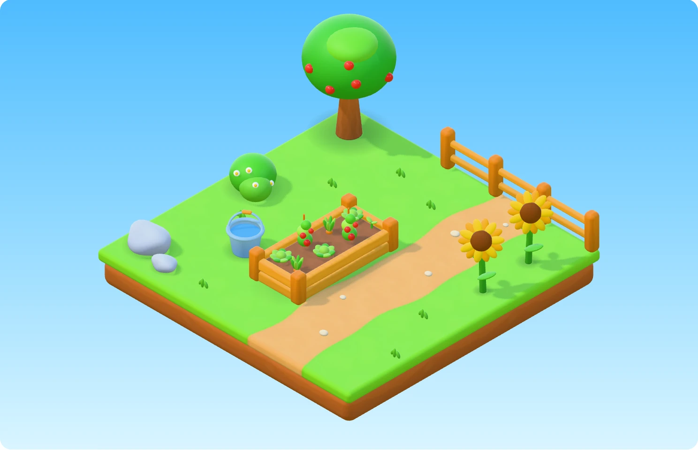

| Today | Renderer only | Full party style |
| --- | --- | --- |
| 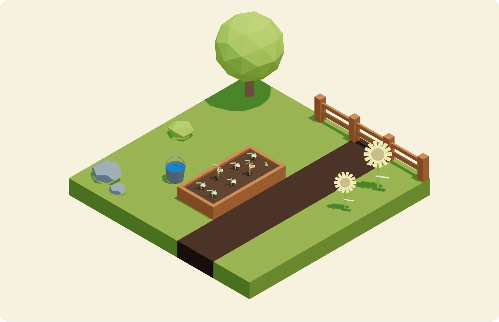 | 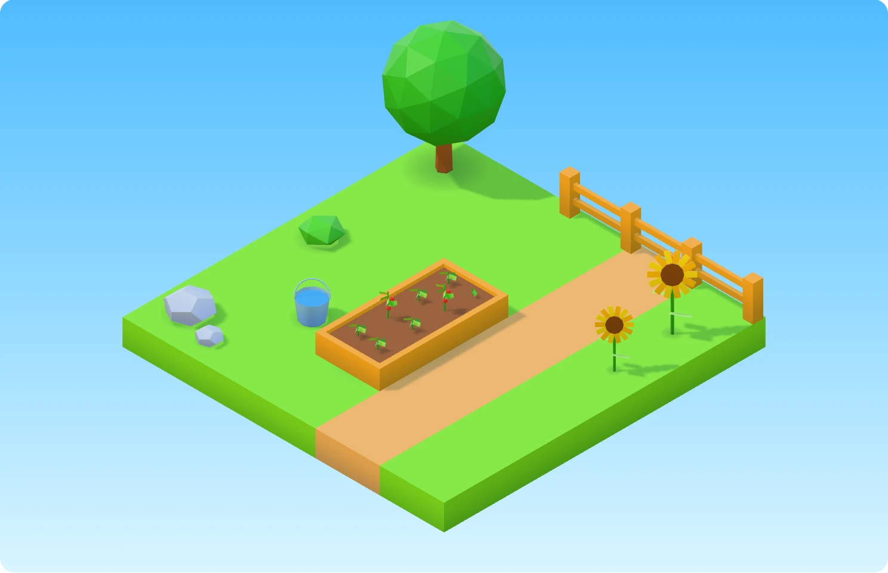 |  |
| Current models, lighting and tone mapping. | Current models with new lighting, tone mapping, colours and a surface gradient. | Reshaped models, a continuous floor and soft painted textures on top of the renderer changes, plus idle motion. |

[`game-party-style/example-scene.html`](game-party-style/example-scene.html) is
the interactive version. Open it in a browser, switch between the three modes,
drag to rotate, and in the party mode hover or click a block. Add
`?mode=current`, `?mode=code` or `?mode=party` to open one mode directly.

The example is a standalone three.js page, not game code. Its "Today" mode is a
reconstruction: each block is rebuilt from the bounds and material factors of
the exported GLB and lit with the midday values from
`packages/game/src/scene/Environment.tsx`. Its grass top renders at `#9bb453`,
against `#8fac4c` in `apps/www/public/assets/blocks/Block_Grass.webp`. It leaves
out the ground patch shader, grass tufts and generated crops, so treat it as a
close approximation of today's look, not a capture. The textures in the party mode
are embedded copies of the generated files in `assets/game-textures`.

## What defines the look

1. **Rounded, chunky shapes.** No hard edge anywhere. Parts are thick, heads
   and fruit are oversized, and objects are built from a few large masses.
2. **Smooth shading.** Surfaces are continuous. Faceted low-poly shading is
   not part of the style.
3. **Clean, saturated colour.** Greens lean yellow, wood is golden-orange,
   stone is a cool light grey. Nothing is olive, muddy or pure grey.
4. **Warm light, cool shadow.** One warm key light, a blue fill and a cool rim
   highlight. Shadows are tinted, soft and never black.
5. **Soft painted textures, semi-gloss surfaces.** Soil, wood, bark and stone
   carry very calm painted variation. Grass, canopies, steel, fruit and water
   stay close to flat colour. Nothing is metallic or photographic.
6. **A continuous floor with a soil rim.** The ground is one surface. Its
   outer edge is rounded and shows a layer of soil underneath.
7. **Bouncy motion.** Things squash and stretch when placed or touched, and
   living things breathe slightly at rest.

We borrow these principles only. Characters, logos, board spaces, interface
motifs and specific props of the reference game are out of bounds.

## Where the game is today

Measured on 2026-11-22 from the 175 exported models in
`apps/garden/public/assets/models` and the scene code in `packages/game/src`,
before any change. The sections from here to the end are the original plan;
what was built is in [Implemented in the game](#implemented-in-the-game).

| Finding | Evidence |
| --- | --- |
| Edges are sharp | 223 mesh parts are plain 24-vertex boxes, including the grass and soil terrain blocks. `assets/bevel-timber-models.py` adds bevels of 0.006 to 0.012 units, which is about one pixel at the default zoom of 100 pixels per unit. |
| Colours are dark and olive | Grass is `#687529`, soil `#462e22`, timber `#7d4422`, stone `#5d5d5d`. Average saturation across untextured materials is 0.46. |
| Lighting is about three times too bright, then compressed | At midday the scene adds a white ambient light at 3, a hemisphere light at 5 and a sun at 5. A sunlit top face receives roughly 3 times the light that would show its albedo unchanged. ACES filmic tone mapping (the react-three-fiber default, never overridden) then pulls that back down, which lightens and desaturates. Grass authored as `#687529` shows as about `#8fac4c` in `Block_Grass.webp`. |
| Shadows are grey-green, not coloured | The fill is flat white ambient. The hemisphere light's sky colour has its red channel zeroed and its ground colour resolves to near black for the default background (`Environment.tsx`, `hemisphereSkyRed * -0` and `backgroundColor.r / 255`). Both look unintended and are worth confirming. |
| Metalness only darkens | 47 materials use metalness above 0 (grass 0.4, soil 0.6, tree trunk 0.5). The scene has no environment map, so there is nothing to reflect and metalness just removes diffuse colour. |
| Surfaces are fully matte | Average roughness is 0.82. Only 63 of 629 materials are below 0.6. |
| Almost nothing is textured | 19 of 1,574 mesh parts use a texture. 1,209 parts carry UVs and 365 do not. The existing UVs have not been checked for texel density or grain direction. |
| Flat faces show one flat colour | The camera is orthographic and the sun is directional, so the light, view and normal vectors are constant across a flat face. A sharp box can only ever show three flat colours. Gradients and highlights need curved surfaces or a shader. |

The last row is the main reason bevels matter here more than in a perspective
game: without curvature the lighting has nothing to draw.

## What changes

Size is relative: S is days, M is one to two weeks, L is several weeks. These
are estimates from reading the code, not measured.

### 1. Renderer and lighting (no model changes)

| Change | Where | Size |
| --- | --- | --- |
| Switch tone mapping from ACES filmic to Khronos neutral, exposure 1 | `Scene.tsx` canvas setup. `StaticOpaqueSceneCache.tsx` only enables itself when tone mapping is ACES filmic, so that check and its replay path must be updated together. | S |
| Rebalance lights so a sunlit top face shows about 1× albedo: warm key, hemisphere fill with a cool sky and warm ground bounce, a cool fill light opposite the sun, no flat ambient | `useEnvironmentElements` in `Environment.tsx`. Every time of day, weather state, moonlight and eclipse scale multiplies these values, so each needs a visual pass. | M |
| Add a small generated sky environment map for soft reflections | New, next to `SkyGradientBackground.tsx`. One low-resolution map regenerated when the sky colour changes noticeably. | S |
| Softer, lighter shadows | Directional light shadow props in `Environment.tsx` (radius 2.2 today), `ShadowMapController.tsx`. | S |
| Contact shadow under every standing object | `PlacementGroundingShadows.tsx` and `ActorGroundingShadows` already do this for placement and animals. Extend to static entities. This also carries the low quality tier, which has no shadow map. | M |
| Shared "toy surface" shader hook: height gradient and sky rim | New decorator registered through `registerGardenMaterialShaderHooks` in `gardenMaterials.ts` so static render packets still batch. It has to compose with `cloudShadowAttenuation.ts`, `weatherSurfaceMaterial.ts` (snow and wet overlays), `groundPatchMaterial.ts` and `AutumnPropWindMaterial.tsx`. | M |
| More saturated day sky | `skyGradient.ts`, `backgroundPalettes.ts`. The default day background is cream `#F7F1DD`. | S |

### 2. Palette (mostly data)

| Change | Where | Size |
| --- | --- | --- |
| New albedo values per colour role, metalness 0, roughness by band | Blender materials in `assets/game-assets/*.blend`, re-exported. As a bridge, normalise by material name when a model loads (`useGameGLTF`, `scene/resources/gameGLTFResources.ts`). Only some names are shared: `Material.Planks` covers 11 models, but there are 534 unique names across 629 materials. | M |
| Regenerate the palette atlas | `assets/GredicePixPal_BaseColor.png`, used by textured models such as `Bush`. | S |
| Shader-owned colours | `groundPatchMaterial.ts` presets, `scene/autumnPalette.ts`, `scene/waterColors.ts` (now `scene/waterColorState.ts`), `entities/dryGroundPalette.ts`. | S |
| Crop colours | Hex values in `generators/plant/lib/plant-presets/*.ts`. | M |

Colour and lighting must ship together. Bright albedo under today's lighting
washes out, and today's dark albedo under the new lighting looks murky.

### 3. Textures

| Change | Where | Size |
| --- | --- | --- |
| A shared set of about a dozen painted, tileable textures: grass, path, soil, terrain soil body, light and dark wood, bark, stone, foliage, seeds | New image files loaded through `scene/resources`. Material signatures in `gardenMaterials.ts` compare textures by identity, so materials that share one texture instance still batch. | M |
| World-projected ground textures and a ground-type mask | Part of the toy surface shader. Projection from world axes needs no UVs and lines up across separate block meshes, which is what makes the floor continuous. The mask says where grass ends and path begins and has to be built per garden from block types. This replaces the procedural patches in `groundPatchMaterial.ts`. | M |
| Textures on props | Two routes. World projection in the shader works without touching models but costs three texture reads per pixel and cannot follow a rotated plank. UVs are cheaper and controllable, but 365 parts have none and the rest need checking. Use projection for terrain, soil, stone and canopies, and UVs where direction matters, such as timber. | L |
| Colour that code controls | Seasonal canopies (`scene/autumnPalette.ts`) and colour variants of one prop need textures authored as light and dark variation that multiplies the role colour. | S |
| Snow, rain and wind | `weatherSurfaceMaterial.ts` overlays and `AutumnPropWindMaterial.tsx` must keep working on textured surfaces. | S |

The example scene uses world projection everywhere, which is why it needs no
UVs. No compressed texture pipeline was found in the loaders, so budget for
plain RGBA: about 0.35 MB of GPU memory per 256 pixel texture and 1.4 MB per
512 pixel texture, with mipmaps.

### 4. Models

| Change | Where | Size |
| --- | --- | --- |
| Terrain blocks: continuous floor, rounded rim and soil body on exposed edges only | `generate-terrain-blocks.py` and the `Block*` entities. Inner faces stay flush with no bevel. Edge and corner pieces are chosen from each block's neighbours, as fences and raised beds already do with `useEntityNeighbors`. | M |
| Raised bed: thick stacked planks, corner posts, domed soil | `RaisedBed.blend`, `entities/raisedBed` (55 files). The bed is the centre of the product, so it deserves hand work. | M |
| Tree and bush canopies: clustered smooth puffs | `TreeCanopyBatch.tsx`, `BushCanopyBatch.tsx`, `scene/bushFoliage.ts`, `autumnFoliageGeometry.ts`. Autumn thinning stages are separate meshes and need matching shapes. | M |
| Generated crops: thicker stems, rounder leaves, larger fruit | `generators/plant` leaf, stem and vegetable geometry. Crops must stay recognisable as their species. | L |
| Catalogue props | 175 `.blend` sources and 41 generator scripts. A scripted pass (bevel with 2 to 3 segments at visible widths, weighted normals, smooth shading) should cover box-like timber and stone. Hero props and organic shapes need manual rework. | L |
| Animals and avatar | `entities/animals`, `entities/avatar`. Not audited here. Do them last, since they are animated and fewer in number. | M |

Bevels add vertices. A rounded box is roughly 4 to 10 times a sharp one,
depending on bevel segments (an estimate, not measured). The
retained chunk and static packet pipeline was built for today's counts, so
measure with the existing `profile:game` scenarios in `apps/garden` before
committing to bevel segment counts, and consider fewer segments on lower
quality tiers.

### 5. Motion

| Change | Where | Size |
| --- | --- | --- |
| Squash and stretch on place, pick up, harvest and tap | `PlacementDropAnimation.tsx` (a 0.1 lift today), `scene/sceneSpring.ts`. | S |
| Hover pop alongside the existing outline | `HoverOutline.tsx`. | S |
| Idle breathing on canopies, crops and flowers | Should run in the vertex shader like the existing wind materials so static batches stay static. | M |

All of it must respect `prefers-reduced-motion`, as placement already does.

### 6. Interface and generated images

| Change | Where | Size |
| --- | --- | --- |
| Regenerate block, top-down and plant images | `generate-playwright:blocks`, `generate-playwright:blocks:top-down` and `generate-playwright:plants` in `apps/www`. These feed the public block pages and the 2D garden overview. | S per run |
| HUD in the same language: thick rounded panels, bold display type, soft shadows, bouncy transitions | `packages/game/src/hud`. Icons already match (`inventory-backpack.webp`, `shopping-basket.webp`, `tutorial-task-list.png`). Treat as a separate project. | L |

## Suggested phases

1. **Decide and write down.** Agree the open decisions below, adopt
   [GAME_ART.md](../GAME_ART.md).
2. **Renderer and palette together** behind a flag: tone mapping, lights,
   environment map, contact shadows, toy surface shader, colour normalisation
   on load. Review at dawn, midday, dusk, night, overcast, rain and snow.
3. **Ground:** the shared texture set, world-projected ground textures, the
   ground-type mask and neighbour-aware terrain edges. This delivers the
   continuous floor.
4. **Core set:** raised bed, tree, bush, fence, stones and the most common
   crops, reshaped and textured. This is what every garden shows.
5. **Motion.**
6. **Catalogue,** scripted pass first, then manual work by popularity.
7. **Regenerate images,** then the HUD.

After phase 2 the game already looks like the "Renderer only" image.

Status on 2026-11-23: phases 2 to 6 are done, apart from the environment map,
the shared ground textures and ground-type mask, and hover pop on instanced
blocks. In phase 7 the block, top-down and plant images are regenerated; the
HUD is not started.

## Risks and constraints

- **Time of day and weather.** The current rig is tuned across day, night,
  moonlight, eclipse, fog, rain and snow. Rebalancing touches all of them.
  Night should shift toward saturated blue-violet instead of grey.
- **Performance.** More vertices, one more shader hook, an environment map and
  texture reads on surfaces that are flat colour today. No post-processing is
  proposed, so there is no new full-screen pass.
- **Static scene cache.** It assumed ACES filmic output. It now gates on the
  shared tone mapping constant in `gameArtStyle.ts`.
- **Mixed catalogue during migration.** Old sharp props next to new rounded
  ones will look inconsistent. Phase 2 reduces this because colour and light
  unify everything first.
- **Purchased and placed items.** Customers own existing decorations. Shapes
  can change, but footprints, pivots and object names in
  `assets/game-assets.json` must not.
- **Crop realism.** Gredice shows a real garden. Stylise, but keep species
  readable.
- **Reference boundaries.** Principles only, as listed above.

## Open decisions

1. How far to go: the full party style, or stop at "Renderer only" plus bevels
   on the core set? The branch implements the full style.
2. Timber colour: the shared wood moved one step toward the example's gold.
   Go further, or stay here?
3. Do new assets follow the shape rules in [GAME_ART.md](../GAME_ART.md) from
   now on, before the renderer work lands?
4. ~~Seasonal collections: the autumn palette in
   [autumn-art-direction-2026.md](autumn-art-direction-2026.md) is deliberately
   muted and matte. Does it get a brighter revision or stay as a seasonal
   exception?~~ Decided 2026-11-23: autumn gets the brighter revision, and so
   do every other season and every time of day: night, dawn and sunrise,
   morning, sunset and dusk. See "Time of day and seasons" in
   [GAME_ART.md](../GAME_ART.md).
5. Shared wood: the catalogue has the default plank (`#875627`, roughness
   0.78, in the matte band), three bridge woods and the dog house's own
   tones, while the animal homes use 0.55. The bridge deep wood shows at a
   value of about 0.49 on the wooden bench and the bridge stringers, under
   the 0.55 floor. Lift the deep wood for everything that uses it, or move the
   bench to the default plank? And which roughness does the shared wood use?
6. Oversized props: the watering can is about 1.25 × 0.39 in the game, and
   the tree (1.12) and pine (1.09) canopies are wider than the 0.9 × 0.9 of a
   1×1 prop. All three are purchased or placed items. Shrink them, or allow
   these overhangs?
7. Night grade: where tops fill the frame, as in the dense garden, night
   reads as midday at about 0.8 of its value, with blue-violet only on shaded
   sides and in the sky. A stronger grade on the tops would conflict with
   grass staying green. Separately, water at night is the brightest surface in
   the scene (value 0.96 against about 0.71 for grass) and reads as if it
   glows. Keep both, or grade them further?
8. Day shadow hue: cast shadows on sand and path are a lilac grey
   (saturation 0.05 to 0.10), not the bluer target of hue 230 to 260 at 0.15
   to 0.25. Pushing further turns gold canopy undersides olive and soil sides
   pink. With the day shade veil, the midday soil side of the terrain reads
   raspberry (`#8e4a5c`). Accept these, or retune?
9. Spring: spring canopies only lean 35% toward the spring green role, and
   there is no blossom pink anywhere in the game. Add blossom, which needs new
   geometry, or accept spring as fresh green only?
10. Advent pine: it is snowed over in every season and weather, so it reads
    as a lilac-white cone on a summer lawn. Keep the permanent snow, or show it
    only in winter weather?
11. ~~Animal colours and budget: sheep wool shows almost pure white and the
    goat's cream is at saturation 0.08, against the neutral range of 0.10 to
    0.25. The horse is a dark chestnut at or under the 0.7 value floor and
    has 3,608 triangles, over the ~3,000 budget. Recolour, and treat the horse
    as a larger actor or cut its resolution?~~ Superseded 2026-11-24 by the
    [Animal redesign](#animal-redesign): warmer creams and whites, retuned
    horse coats, the horse at 3,428 triangles. The animal decisions still
    open are listed there.
